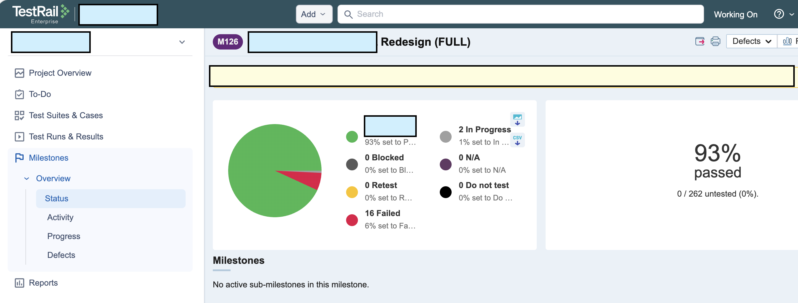

<h1 align="center">mcp-testrail-sync</h1>

<p align="center">
  <b>TestRail MCP server for Claude, OpenCode, Codex and Copilot</b><br>
  Create and read test cases from a plain prompt
</p>

<p align="center">
  
</p>

<p align="center">
  <a href="https://www.npmjs.com/package/mcp-testrail-sync"></a>
  <a href="LICENSE"></a>
  <a href="https://nodejs.org"></a>
</p>

A **TestRail MCP server** that lets Claude Code, Claude Desktop, OpenCode, Codex, GitHub Copilot and other AI clients **read and create TestRail test cases from a plain prompt**.

Works with: Claude Code · Claude Desktop · OpenCode · Codex · VS Code Copilot · any MCP client.


> "Use mcp-testrail-sync to create test cases in section "User registration" from `test_registration.md`"

## Ask your AI things like

- "Create test cases in TestRail from `test_registration.md`"
- "Sync these QA test cases with our TestRail project"
- "List the sections in our TestRail suite"
- "Find TestRail test cases about login"
- "Import these manual test cases into the section *User registration*"

**Safe by design (v1 PoC):**
- **One project and one suite only.** Both are set in the config. Every read is filtered to that suite, and every write is checked against it.
- **No update or delete.** The code simply has no update/delete API calls. The only writes are *create test case* and *create section*.

## Quick start

1. Nothing to install: the client starts the server with `npx -y mcp-testrail-sync`. While this is a test build, use `mcp-testrail-sync@beta`.
2. Get your TestRail API key: **TestRail → My Settings → API Keys → Add key**.
   The API must be enabled: **Admin → Site Settings → API**.
3. Add the server to your MCP client. Example for OpenCode (`opencode.json`):
   ```json
   {
     "$schema": "https://opencode.ai/config.json",
     "mcp": {
       "mcp-testrail-sync": {
         "type": "local",
         "command": ["npx", "-y", "mcp-testrail-sync@beta", "--project", "demo-name"],
         "enabled": true,
         "environment": {
           "TESTRAIL_URL": "https://your-instance.testrail.io",
           "TESTRAIL_USERNAME": "your-email@example.com",
           "TESTRAIL_API_KEY": "your-api-key",
           "TESTRAIL_SUITE": "test1"
         }
       }
     }
   }
   ```
   Claude Code, in one command:
   ```bash
   claude mcp add mcp-testrail-sync \
     -e TESTRAIL_URL=https://your-instance.testrail.io \
     -e TESTRAIL_USERNAME=your-email@example.com \
     -e TESTRAIL_API_KEY=your-api-key \
     -e TESTRAIL_SUITE=test1 \
     -- npx -y mcp-testrail-sync@beta --project demo-name
   ```
   Configs for **Claude Desktop, Codex and VS Code Copilot** are in [docs/CLIENTS.md](docs/CLIENTS.md).
4. Restart the client and ask: *"Run system_ping from mcp-testrail-sync"*. You should see your project and suite.

<!-- Further screenshots: add the PNG to docs/screenshots/, then add a link in the same absolute raw.githubusercontent.com form as the one at the top (npm needs absolute URLs).
- `01-testrail-api-key.png`: where to create the API key in TestRail
- `02-client-config.png`: the MCP config in your client
- `03-system-ping.png`: a successful `system_ping`
- `04-create-from-md.png`: prompt + created cases in TestRail
-->

## Configuration

Everything lives in the MCP client config: no `.env` files.

| Setting | Where | Example |
|---|---|---|
| `--project` | command arg | `demo-name` or `12` (name or id) |
| `TESTRAIL_URL` | env | `https://your-instance.testrail.io` |
| `TESTRAIL_USERNAME` | env | `your-email@example.com` |
| `TESTRAIL_API_KEY` | env | API key (not your password) |
| `TESTRAIL_SUITE` | env (or `--suite` arg) | `test1` or `34` (name or id) |
| `TESTRAIL_DEBUG` | env, optional | `true` logs each API call to stderr |

If something is missing or wrong, the server stops at startup and lists every problem, e.g. `TESTRAIL_API_KEY is required (TestRail > My Settings > API Keys)`, or `Suite "test2" not found in project "demo-name". Available: "test1" (id 34), ...`.

## Tools (v1)

| Tool | What it does |
|---|---|
| `system_ping` | Checks the connection and shows the locked project/suite, steps format, required fields, and available tools |
| `tests_list` | Lists cases in the suite, filtered by section, title text, priority, type or label; paged |
| `tests_get` | Gets one case with full steps (`123` or `C123`) |
| `tests_search` | Searches cases by title (shortcut for `tests_list` + `search_text`) |
| `tests_create` | Creates 1–50 cases in one call, in sections of the suite |
| `sections_list` | Shows the suite's sections/subsections as a tree, with `Parent > Child` paths |
| `sections_create` | Creates a section, or a subsection when you pass `parent_id` |
| `suites_list` | Shows the configured suite as a tree, optionally with case counts |
| `suites_get` | Gets details of the configured suite |
| `suites_search` | Finds sections in the suite by name and returns their paths |
| `labels_list` | Lists project labels (TestRail 10.5+) |
| `labels_get` | Gets a label by id or title |

**How steps are sent:** at startup the server checks the project's templates.
- If the project has the *Test Case (Steps)* template, steps go in as separated steps (one row per step, each with its expected result).
- Otherwise they go in as numbered text.

Fields the project marks as required are shown by `system_ping`. Pass them through `custom_fields` in `tests_create`.

## Example prompts

See [examples/prompts.md](examples/prompts.md) and the sample [examples/test_registration.md](examples/test_registration.md).

## Development

```bash
npm install
npm run build      # compile TypeScript to dist/
npm test           # unit + tool tests against an in-memory fake TestRail
npm run inspect    # open MCP Inspector (set the TESTRAIL_* env vars first, then add --project in the UI)
```

New to MCP? Read [docs/HOW_MCP_WORKS.md](docs/HOW_MCP_WORKS.md). It walks through this codebase and shows how to add a tool.

## Roadmap (v2+)

Update/delete with confirmation, test runs/plans/results, creating suites, a read-only mode, a duplicate-title check before create, attachments, shared steps, HTTP transport.

## License

MIT
